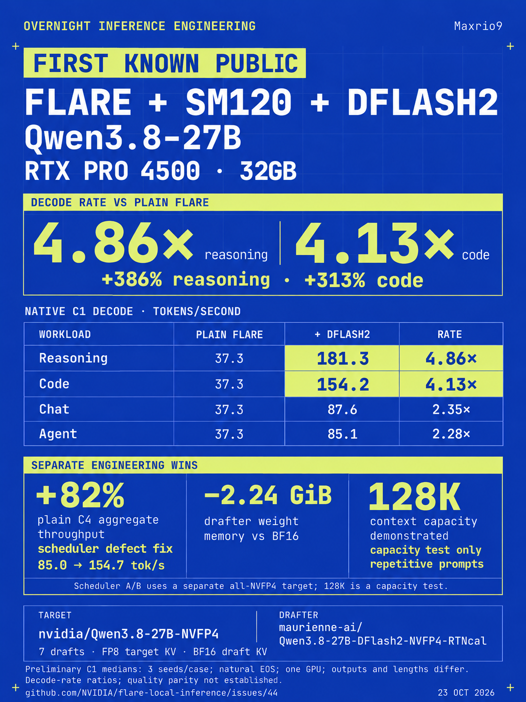

# Qwen3.8-27B + DFlash2 on Flare / SM120

**Up to 4.86× native decode rate over plain decode in the reasoning case.**
One RTX PRO 4500 32GB, C1, three seeds/case, natural EOS; this is a ratio of
per-arm medians with different generated outputs and lengths.
An experimental source distribution combining the Qwen3.8-27B
DFlash2 recipes, engine fixes and memory improvements from our local experiments.
To our knowledge, the first public Flare + SM120 + DFlash2 configuration for this model;
this is a qualified priority claim, not an exhaustive historical survey.



Infographic generated with OpenAI imagegen; its figures come from the included
measurements. The [caption-edit prompt](docs/images/qwen38-dflash2-sm120-v5-prompt.txt)
is included.

| Workload | Plain decode | NVFP4 DFlash2 | Decode gain |
|---|---:|---:|---:|
| Chat | 37.3 tok/s | 87.6 tok/s | 2.35× |
| Code | 37.3 tok/s | 154.2 tok/s | 4.13× |
| Reasoning | 37.3 tok/s | 181.3 tok/s | 4.86× |
| Agent | 37.3 tok/s | 85.1 tok/s | 2.28× |

C1 native decode rates, median of three runs per case, natural termination.
Different generated text and lengths across arms; these are decode-rate comparisons,
not equal-work latency or quality-equivalence results. [Request fixtures and measurement rows](docs/sm120-results.md) are included.
The [full comparison table](docs/sm120-results.md#c1-decode-results) also includes
built-in fixed-depth MTP3 and MTP7 from the same recipe family.
The infographic's memory, scheduler and 128K figures come from separate experiments.

## What is included

- BF16 and calibrated NVFP4 **DFlash2** recipes, plus native MTP and ordinary decode.
- The **paged-attention unused-V-tail NaN fix**, pinned in the public FlashInfer
  dependency: unused value-cache tail rows must not propagate NaNs into valid
  decode attention. The defect was reproduced with both BF16 and FP8 KV.
- Draft state handling for speculative commit, snapshot/restore and prefix reuse.
- Pinned-host export readbacks and preserved export integrity checks.
- Dense MLP and attention preparation-memory improvements.
- The generic **feedback-window scheduler fix**: final prefill chunks remain visible
  while ordinary decode is in flight, and the selected feedback plan drains safely.
- Tests, source, exact dependency pins and an export example for C1/C4 and 32K/64K/128K.

The measured target uses **FP8 target KV**; the DFlash2 context ring uses **BF16 draft KV**.
NVFP4 describes checkpoint weights, not every tensor or the KV cache.

## Exact weights

| Role | Checkpoint | Pinned revision |
|---|---|---|
| Target | [nvidia/Qwen3.8-27B-NVFP4](https://huggingface.co/nvidia/Qwen3.8-27B-NVFP4) | `482ca0f3832238542f8f5295dde86b5f22711d80` |
| Recommended drafter | [maurienne-ai/Qwen3.8-27B-DFlash2-NVFP4-RTNcal](https://huggingface.co/maurienne-ai/Qwen3.8-27B-DFlash2-NVFP4-RTNcal) | `bd7a934213c47a9e7ef69eef36bb3325f47fd1f1` |
| BF16 comparison drafter | [z-lab/Qwen3.8-27B-DFlash2](https://huggingface.co/z-lab/Qwen3.8-27B-DFlash2) | `50307d4c4cde6860d4eee73e2547cd786fe8e8a4` |

Model weights are downloaded from their publishers, not included in this repository.
All three linked checkpoint cards declare Apache-2.0; their licenses and access
conditions remain applicable. DSpark was researched but is
**not implemented** here.

## Build and run

Linux, Python 3.12, a recent Rust toolchain, CUDA toolkit with CUPTI, and a compatible
NVIDIA driver are required. The measured system used driver 615.78.08, PyTorch
2.14.1+cu132 and an RTX PRO 4500 Blackwell (SM120), 32GB. RTX 5090 is also SM120,
but its performance has not been measured here.

The fresh export example and native runtime were qualified in the existing
pinned preparation environment. An anonymous clone and locked dependency
resolution were checked; a completely new environment installation followed by
the exact `ignition run` quickstart below has **not** been tested end to end.

Install the native prerequisites listed in [environment setup](docs/model-preparation.md#environment-setup),
including CMake, Ninja, a C/C++ compiler, protoc, OpenSSL and liburing headers. Then:

```sh
git clone https://github.com/Maxrio9/flare-qwen38-27b-sm120.git
cd flare-qwen38-27b-sm120
uv sync --locked --extra prepare --extra test
cargo build --locked --release --manifest-path flare/Cargo.toml
.venv/bin/ignition run qwen3.8-27b-dflash2-nvfp4 --gpus 0 \
  --host 127.0.0.1 --port 8000 --mtp-draft-tokens 7 \
  --no-mtp-adaptive-verification
```

The first run downloads the exact checkpoints, compiles the graph catalog and exports
a native package; later runs reuse it. Allow disk space for the environment, model
cache, compiler cache and exported payloads. Package assembly can temporarily
hold multiple roughly 22 GiB copies: allow at least **60 GiB free on the export
output filesystem**, in addition to the model/environment caches. Put `--output`
on that volume when using the export example below. The default recipe is deliberately
**C1 / 32K / prefill 512**. The BF16 comparison alias is `qwen3.8-27b-dflash2`.
Sampling defaults follow the target recipe; supply the workload preset explicitly
when reproducing the table.

For the larger experimental catalog:

```sh
.venv/bin/python examples/export_qwen38_dflash2.py \
  --output ./runtime/qwen38-dflash2/model.safetensors \
  --context 65536 --concurrency 4
```

The example fixes prefill chunks at **1024** and captures widths 1, 4 and 8.
Use `--context 131072` for the separately checked capacity configuration. Capacity
is an upper bound per request, not a promise that four maximum-length requests fit
simultaneously. Memory planning and admission still enforce physical limits.
Run the resulting package locally:

```sh
flare/target/release/flare run ./runtime/qwen38-dflash2/model.safetensors \
  --gpus 0 --host 127.0.0.1 --port 8000 --mtp-draft-tokens 7 \
  --no-mtp-adaptive-verification
```

Follow the [local signing instructions](docs/cli-design.md#signing-and-local-development)
for first-use approval. A custom configuration directory may require an explicit
`--publisher-keys` path to **your own** generated development publisher profile.
The exporter creates **your own** development identity; no private signing key or
prebuilt encrypted package is distributed. Keep the metadata file and its sibling
payload files together. Do not use another person's signing credentials.

See [validation and limitations](docs/sm120-results.md#validation-and-limits) before
using the experimental memory changes. In particular, attention scratch at prefill
4096 is not GPU-qualified; the supplied larger-capacity example uses 1024.

The combined runtime built successfully and passed **220 scheduler tests**,
**4 poisoned-tail CUDA cases**, and **52/52 native requests on a freshly exported
C4/64K package**, including prefix reuse. Details and remaining gaps are in the
[qualification report](docs/sm120-results.md#validation-and-limits).

## Relationship to upstream

This is an independent experimental distribution of [NVIDIA Flare](https://github.com/NVIDIA/flare-local-inference),
not an NVIDIA release. It preserves the original Apache-2.0 license, NOTICE and history.
This modified fork has its changes listed in Git history.
Its frozen source base is `5f37bd1`, with the published experimental stack and a focused
scheduler backport. Upstream was checked again on 2026-10-23 at `a773e68`; it now has
its own dense-Qwen MTP support. This distribution is **not a rebase onto that main**.
Older measured packages and newer native measurements are distinguished in the results.

Related upstream reports: [scheduler defect #42](https://github.com/NVIDIA/flare-local-inference/issues/42),
[scheduler PR #43](https://github.com/NVIDIA/flare-local-inference/pull/43),
[DFlash2 proposal #44](https://github.com/NVIDIA/flare-local-inference/issues/44),
[MLP memory #45](https://github.com/NVIDIA/flare-local-inference/issues/45), and
[attention memory #46](https://github.com/NVIDIA/flare-local-inference/issues/46).
The dependency is pinned to [the public FlashInfer backport](https://github.com/Maxrio9/flashinfer/tree/qwen38-sm120-pv-tail-20261023)
(`cd5bbf71ffd9a3a8feeb8e62c8d48c07af7205c3`), based on the measured `03de0b66` API;
no manual site-packages patch is required.

Code was written with Codex (GPT-6). Claude Opus 5.5 reviewed earlier model math and
contracts; Claude Sonnet 5.5 reviewed scheduler policy, semantic tests and claims.
Claude did not review or author the kernel/scratch/fusion changes. See the
[original project overview](README.upstream.md) and [contributor rules](AGENTS.md).
